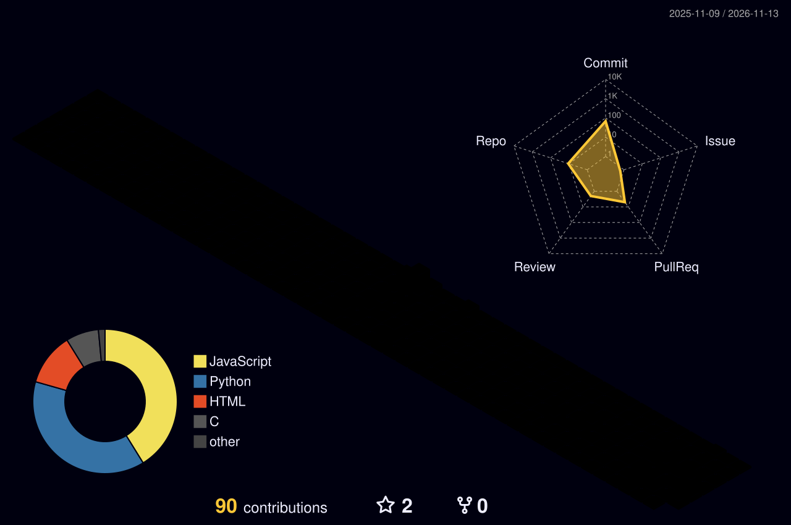

  

## Hi, I'm Naomi

I build AI agents and automation for businesses.

My work does three things:

- **It saves time.** Work that took hours now takes seconds.
- **It is safe.** The AI has limits, and a person approves the big steps.
- **It shows proof.** Every answer links back to where it came from.

## What I can build for you

| You have this problem | I build this |
|---|---|
| Your team copies data between many sheets | One dashboard that reads them all |
| You answer the same questions every day | An AI assistant that answers from your own data |
| You lose track of clients and follow-ups | A simple CRM that fits how you work |
| You do not trust AI with real work | An AI agent with checks, limits and a clear record |

## Some of my work

| Project | What it does |
|---|---|
| [**Hatua**](https://github.com/NaomiKwamboka0/the-long-view) | Helps Kenyan teachers see each learner's story from Grade 4 to Grade 9. Nothing is saved until a teacher approves. |
| **Revenue Intelligence App** | Brings money data from more than 20 platforms into one dashboard. Hours of adding by hand now take seconds. |
| [**MathBench**](https://github.com/NaomiKwamboka0/mathbench-1) | Three AI agents plan, solve and check maths answers. It caught wrong answers a normal answer key missed. |
| **Vendor Scout** | Finds online sellers and ranks them, so a sales team never calls the same seller twice. |

More projects: [my portfolio](https://naomikwamboka0.github.io/n8n-Profile)

## My tools

Python · JavaScript · Google Apps Script · n8n · LangGraph · MCP servers · Claude and Gemini APIs · AWS · Google Cloud · Docker

## My year in 3D

  

## Work with me

Tell me the one task that wastes most of your team's time. I will tell you if I can fix it.

[LinkedIn](https://www.linkedin.com/in/naomi-kwamboka) · [Portfolio](https://naomikwamboka0.github.io/n8n-Profile) · [Certificates](https://www.credly.com/users/naomi-onyancha)
